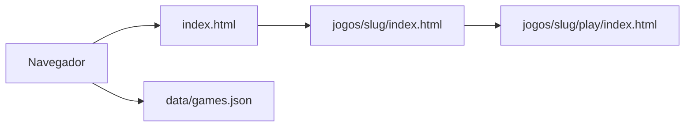

# 02 — Arquitetura

## Decisão vigente

Site estático. HTML, CSS e JavaScript. O navegador baixa as páginas e os arquivos do jogo. Não há servidor de aplicação, banco nem API.

A escolha substitui o desenho anterior com Next.js e Django. O histórico está em [10-DECISOES-TECNICAS.md](10-DECISOES-TECNICAS.md).

## Como uma visita funciona



- A home e a ficha são HTML do Zuplay, com texto, capa e anúncio.
- O iframe da ficha aponta para `play/index.html` daquele jogo, ou para uma URL HTTPS de parceiro autorizado.
- `data/games.json` alimenta busca, favoritos e a checagem de links. A ficha publicada também existe como HTML, para a busca orgânica enxergar o texto sem depender do JavaScript.

## Pastas

```text
zuplay/
  index.html
  css/site.css
  js/site.js
  js/search.js
  js/favorites.js
  js/player.js
  js/ads.js
  data/categories.json
  data/games.json
  data/embed-domains.json
  data/ads.json
  assets/games/{slug}/
  categorias/{slug}/index.html
  jogos/{slug}/index.html
  jogos/{slug}/play/index.html
  busca/index.html
  favoritos/index.html
  sobre/index.html
  contato/index.html
  privacidade/index.html
  termos/index.html
  sitemap.xml
  robots.txt
  docs/
  scripts/
```

`jogos/{slug}/index.html` é a ficha. `jogos/{slug}/play/` é o pacote HTML5. Separar as duas pastas evita que o `index.html` do jogo substitua a página do portal.

Pastas e arquivos de site nascem na Fase 1. Esta revisão só atualiza a documentação.

## Publicar um jogo na semana

1. Colocar o pacote em `jogos/{slug}/play/`, com `index.html` na raiz do pacote.
2. Colocar capa e thumbnail em `assets/games/{slug}/`.
3. Acrescentar o objeto do jogo em `data/games.json`, com licença e `status`.
4. Criar `jogos/{slug}/index.html` com o texto, o iframe, os relacionados e os metadados.
5. Incluir o card na home e na página da categoria.
6. Incluir a URL no `sitemap.xml` somente se `status` for `published` e `license.verified` for `true`.
7. Abrir a ficha no navegador, jogar, usar tela cheia e conferir o celular.

Rascunho pode existir no JSON e no disco, sem card na home e sem linha no sitemap.

Quando o número de jogos tornar o passo 4 e o passo 5 repetitivos, um script em `scripts/` pode gerar a ficha e os cards a partir do JSON. Esse script fica para uma fase posterior e não entra como dependência da Fase 1. Até lá, as páginas são escritas à mão para o catálogo pequeno.

## Iframe

Na ficha:

```html
<iframe
  src="play/index.html"
  title="Corrida do Bosque"
  sandbox="allow-scripts allow-pointer-lock"
  allow="fullscreen"
  referrerpolicy="no-referrer"
></iframe>
```

`sandbox` sem `allow-same-origin` impede o jogo de ler o DOM e o `localStorage` do portal. No site estático isso basta, porque não há cookie de admin.

Parceiro autorizado usa `src` absoluto HTTPS. O host precisa estar em `data/embed-domains.json` e a licença precisa ter `allowsEmbedding: true`. A ficha continua com texto do Zuplay em volta do iframe.

## Busca e favoritos

A busca carrega `data/games.json` e filtra no navegador por nome, categoria e tag. A página `/busca/` existe para a pessoa usar o site. Ela leva `noindex`.

Favoritos guardam slugs em `localStorage`, na chave `zuplay.favorites`.

`fetch` do JSON não funciona em `file://`. O desenvolvimento abre um servidor estático local, por exemplo `python -m http.server`, na pasta do site. A Fase 1 registra o comando que foi usado.

## Listas da home

Os blocos leem campos do catálogo, já copiados no HTML da home:

| Bloco | Ordem |
| --- | --- |
| Destaques | `homepage.featured`, na ordem do JSON |
| Recomendados | `homepage.recommended` |
| Recentes | `publishedAt` decrescente |
| Populares e mais jogados | `playCount` decrescente |

`playCount` é um número editado no JSON. Sem servidor, o site não incrementa sozinho. Quando existir um medidor externo, o responsável atualiza o número ou troca a regra numa decisão nova.

## Anúncios e eventos

`data/ads.json` guarda `enabled: false` e os slots. `js/ads.js` desenha o placeholder. Com `enabled: false` ele não insere script de rede.

Eventos de clique e de jogo iniciado podem ser funções vazias em `js/site.js` até a Fase 8. Não há tabela de analytics.

## Hospedagem

Qualquer hospedagem de arquivo estático: Cloudflare Pages, Netlify, GitHub Pages ou um nginx servindo a pasta. CDN e HTTPS ficam por conta desse serviço. Não há Compose nesta versão.

O domínio canônico continua pendente. O placeholder dos documentos é `https://zuplay.example`.

## O que saiu do desenho

Next.js, Django, Django REST Framework, PostgreSQL, Redis, Docker, MinIO e painel admin. O catálogo versionado no Git é o painel: o diff mostra o que foi publicado.
