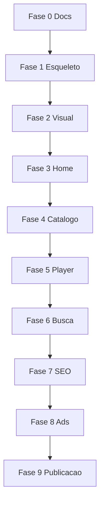

# 09 — Roadmap

Uma fase por vez, com aprovação entre elas. A stack de cada fase é HTML, CSS e JavaScript estático.

## Fase 0 — Planejamento e documentação

Concluída e revisada para o site estático. Sem páginas implementadas.

## Fase 1 — Esqueleto

1. Criar `index.html`, `css/site.css` e `js/site.js` com o mínimo para abrir a home.
2. Criar as pastas `data/`, `assets/`, `jogos/`, `categorias/` e `js/`.
3. Abrir o site com um servidor estático local e anotar o comando.
4. Confirmar que a home mostra o nome Zuplay.

Fora desta fase: visual completo, jogo, busca e anúncio.

## Fase 2 — Visual

1. Variáveis de cor, tipo e raio, nos modos claro e escuro.
2. Conferir contraste dos pares de texto.
3. Cabeçalho, busca, navegação de categorias e rodapé.
4. Card e grade com proporção 16:9.
5. Estados de vazio, erro e esqueleto.
6. Uma página de pré-visualização com cards fictícios.
7. Verificar no navegador em largura de celular e de desktop.

## Fase 3 — Home

1. Montar as faixas da home com jogos fictícios escritos no HTML, marcados como demonstração.
2. Ligar cada categoria a uma rota ainda simples.
3. Manter a grade no HTML, visível com JavaScript desligado.
4. Verificar responsividade no navegador.

Os exemplos não usam jogos nem artes de terceiros.

## Fase 4 — Catálogo e ficha

1. Gravar `data/categories.json` e `data/games.json` no formato do documento 04.
2. Criar um jogo original mínimo em `jogos/{slug}/play/index.html`.
3. Criar a ficha `jogos/{slug}/index.html` com texto, capa e iframe.
4. Criar a página da categoria correspondente.
5. Seguir o checklist de publicação do documento 02 e abrir a ficha no navegador.

## Fase 5 — Player

1. Ajustar sandbox, título acessível e área do iframe.
2. Botão de tela cheia e mensagem se o iframe não carregar.
3. Bloco de relacionados na ficha.
4. Recusar, na revisão da página, URL de parceiro fora de `data/embed-domains.json`.
5. Confirmar que o jogo de demonstração não lê uma chave de teste gravada no `localStorage` do portal.

## Fase 6 — Busca e favoritos

1. Página `/busca/` lendo `data/games.json`, com estado vazio.
2. Filtro por nome, categoria e tag, sem página indexável extra.
3. Favoritos em `localStorage`, com controle no card e página `/favoritos/`.
4. Recarregar e confirmar que o favorito permanece.

## Fase 7 — SEO

1. Title, description, canonical e Open Graph na home, na categoria e na ficha.
2. `sitemap.xml` e `robots.txt` conforme o documento 06.
3. JSON-LD de site, lista, jogo e breadcrumb.
4. Revisar o que está indexável, inclusive a pasta `play/`.
5. Rodar uma medição local e anotar LCP, CLS e INP.

## Fase 8 — Publicidade

1. Slots com placeholder e rótulo “Publicidade”.
2. `data/ads.json` com `enabled: false`.
3. Banner de consentimento com aceitar e recusar.
4. Conferir no HTML servido que nenhum domínio de anúncio é chamado.
5. Página de privacidade em rascunho, marcada como texto ainda não jurídico.

## Fase 9 — Publicação

1. Passagem de acessibilidade nas telas principais.
2. Revisar sandbox, pastas públicas e arquivos de anúncio.
3. Escrever o passo a passo de hospedagem estática e de rollback (voltar o diretório anterior).
4. Deploy continua dependendo de aprovação explícita.

## Ordem

## Riscos

| Risco | Efeito | Resposta |
| --- | --- | --- |
| Repositório pai compartilhado | Arquivos do Zuplay misturam com outros projetos | Repositório próprio antes do primeiro commit de código |
| Abrir a home em `file://` | `fetch` do JSON falha | Servidor estático local desde a Fase 1 |
| Ficha que é só iframe | Página fraca para busca e para anúncio | Texto original obrigatório na ficha |
| Jogo que exige `allow-same-origin` | Sandbox mais frouxo | Exceção registrada por jogo, não como padrão |
| AdSense ainda sem conta | Sem receita no início | Placeholder até a rede aprovar o site |
| Categoria infantil com anúncio comum | Risco de política | `childDirected` desliga personalização |
| Catálogo crescendo só na mão | Home e sitemap ficam para trás | Checklist semanal; script gerador só quando doer |
